# How the timing and ML experiment works

This guide explains the project at a high level. For commands to run it, use the
[Linux runbook](pswd-checker-v2/LINUX_RUNBOOK.md) or the
[Windows instructions](pswd-checker-v2/README.md).

## The experiment in plain language

Our password checker compares characters one at a time and returns as soon as
it finds a mismatch. A guess that matches more of the password can therefore
take a little longer to reject.

We try each possible next character, measure it repeatedly, and use those
measurements to extend our guess. There are two ways to choose a character:
choose the one with the largest median timing, or let a trained model combine
several timing patterns before choosing.

The Linux experiment adds no sleeps or extra per-character workload. It times
batches of unchanged comparisons to make small differences easier to observe.
The passwords are synthetic, their length and alphabet are known, and the
checker runs locally in the same process as the experiment.

We also repeat the attack against a fixed-work control, which compares all
characters before deciding whether the guess is correct. This helps us check
whether our method is responding to the early-exit behavior.

## Workflow diagrams

[PNG version](docs/workflow.png) · [Editable Mermaid diagram](docs/workflow.mmd)

During data collection, we know the synthetic passwords so we can label the
examples. During blind recovery, the search builds its own prefix without
being given the correct characters. Its basic loop is:

Once the guess reaches the expected length, the fixed-mode experiment submits
it for one acceptance check. A good timing score alone does not count as recovery.

## What the files do

Most of the current work is in `pswd-checker-v2/`:

| File or folder | What it does |
| --- | --- |
| [`research_pipeline.py`](pswd-checker-v2/research_pipeline.py) | Runs the four main stages: collect data, train, evaluate, and export |
| [`native_attack.py`](pswd-checker-v2/native_attack.py) | Connects Python to the compiled checker and returns its measurements |
| [`native_linux.c`](pswd-checker-v2/native_linux.c), [`native_windows.c`](pswd-checker-v2/native_windows.c) | Implement the checkers and measure batches using the platform's timers |
| [`recovery.py`](pswd-checker-v2/recovery.py) | Builds guesses, gathers samples, chooses characters, and tracks query budgets |
| [`timing_model.py`](pswd-checker-v2/timing_model.py) | Turns timings into features, learns weights, and scores candidates |
| [`splits.py`](pswd-checker-v2/splits.py), [`lab_config.py`](pswd-checker-v2/lab_config.py) | Generate unique synthetic passwords, assign splits, and check input constraints |
| [`experiment_schema.py`](pswd-checker-v2/experiment_schema.py) | Keeps platform-specific feature names, units, and saved formats consistent |
| [`diagnose_linux.py`](pswd-checker-v2/diagnose_linux.py) | Checks known-prefix timing patterns and produces plots before training |
| [`feature_ablation.py`](pswd-checker-v2/feature_ablation.py) | Tests whether the richer features help compared with a smaller feature set |
| `build_native.sh`, `build_native.ps1`, `setup_linux_env.sh` | Build the native library and prepare the Linux plotting environment |
| `test_v2.py`, `test_linux.py` | Check the experiment logic, data separation, budgets, and native behavior |
| `colab_train.ipynb` | Optionally trains an exported dataset in a CPU Colab session |
| `models/`, `datasets/`, `research_results/` | Store learned weights, measurements, and evaluation reports |
| [`docs/results/`](docs/results/README.md) | Contains selected saved reports and plots |

`naive-checker/` contains the small original Python checker. `pswd-checker-v1/`
preserves the earlier Windows experiment. The notebook-media and presentation
folders contain figures and slides rather than code used to run the attack.

## Why Windows and Linux differ

The overall experiment is the same, but the operating systems provide different
measurement and build tools. Windows builds a DLL with MSVC and uses Windows
APIs for elapsed time, thread cycle accounting, and CPU affinity. Linux builds
a shared library with GCC or Clang and uses Linux clock and affinity APIs.

Both versions record TSC reference ticks. Their third measurement differs:
Windows records thread cycle accounting, while Linux records thread CPU time
in nanoseconds. We keep separate feature schemas and train fresh models for
each platform rather than treating those quantities as interchangeable.

The Windows version also includes library, trie, and staged-hashing checkers.
The Linux pilot focuses on the naive checker and its fixed-work control.

## The models and their inputs

The main model is a **linear ranker**: it gives each candidate a score by adding
up its timing features multiplied by learned weights. Training uses group
softmax, which compares the candidates for one position together.

V1 uses 18 features. V2 uses 42, built from three measurement channels:
TSC ticks, elapsed time, and thread accounting. For each channel, it looks at
central timing, upper and lower quantiles, spread, and consistency across
rounds. It also includes features for the final position, where a full match
and a last-character mismatch can be especially hard to distinguish.

V2 has a second model, a **logistic prefix detector**, with 14 inputs describing
the candidate group and current progress. It tries to recognize when an earlier
wrong guess has made the current prefix unhelpful. The fixed-sample Linux pilot
trains this detector but does not use it to prune guesses.

These are small models trained from our measurements. They do not receive
password text or character identities as input. The median baseline has no
learned weights: it simply picks the candidate with the largest median TSC time.

## Where the training data comes from

We generate the dataset ourselves on the Linux server. The passwords are random
synthetic examples, but the timings come from actually running the C checker.
For each candidate, we repeatedly time batches of 1,000 comparisons and turn
the readings into features such as medians, percentiles, spread, and consistency.

For example, if the training secret is `a7b2` and the known prefix is `a7`, we
measure candidates beginning with `a7a`, `a7b`, `a7c`, and so on, padding each
guess to the same length. We label **b** as the correct next character. The
model learns from the timing features and labels; the letters themselves are
not model inputs.

The October 28 pilot generated 18 passwords: 12 for training, 3 for validation,
and 3 for testing. Each password produces many measurement groups, so 12 training
passwords means more than 12 training rows, while still only covering 12 distinct
training secrets.

On the server, inside `pswd-checker-v2/`, the dataset is saved under
`datasets/20261028T180716Z-pilot/`:

- `raw/`: the recorded timing measurements.
- `features/`: the derived timing features and labels.
- `manifest.json`: the generated passwords, splits, and experiment settings.

## How training works

1. **Collect examples.** Use known synthetic passwords to measure candidates
   after correct prefixes. V2 also measures deliberately wrong prefixes so the
   detector has examples of both cases.
2. **Split by password.** Keep all measurements of one password in the same
   training, validation, or test split. Otherwise, closely related observations
   could appear on both sides of the evaluation.
3. **Learn and validate.** Fit the weights on training data using the Adam
   optimizer. Use validation data to choose regularization and optional sampling
   settings. Regularization helps limit how much the model fits noise.
4. **Test on held-out passwords.** Save the model, then collect fresh measurements
   while recovering the test secrets. The search must use its own predicted
   prefixes, which is harder than being given correct prefixes during calibration.

The learned weights and settings are saved in `model.json`, along with the
feature names and experiment fingerprints. Training can run on a CPU, including
on a Mac from exported features. Fresh recovery uses the matching native target
and original experiment files. Test feature files are not opened during training.

## What ML can add

Median timing is a useful starting point, but it relies on one summary of one
measurement channel. A model can combine several clues. If two candidates have
similar medians, their spread, other timing channels, or consistency across
rounds may help separate them. The final-position features let it learn a
different pattern for the last character.

That flexibility has a cost: ML needs labeled data, training, and validation.
It can also learn noise that does not carry over to another session or machine.
It still needs a useful timing signal from the checker.

In our fixed-mode pilot, both methods used the same query budget. ML recovered
one additional password; it did not use fewer requests or demonstrate faster
recovery. We need a larger independent study before claiming a general advantage.

## Tests and results so far

The Linux port was checked on the project server in October 2026:

| Check | Recorded outcome |
| --- | --- |
| V2 portable and Linux native tests | 20 passed; the Windows-only native test skipped |
| Original checker and V1 portable suites | Passed; Windows native checks were not rerun on Linux |
| Compiled checker inspection | The vulnerable checker retained its early exit; the control compared every byte |
| Known-prefix diagnostics | Longer matching prefixes took longer in the naive checker; control timings stayed comparatively flat |
| Portable training export | Linux features successfully trained on the Mac without a native library |

The [October 28 pilot](docs/results/linux-pilot-2026-10-28/README.md) completed
36 data shards for 18 passwords: 12 training, 3 validation, and 3 test. Both
ranking methods used the same per-password budget and one final acceptance check.

| Checker | ML recovered | Median recovered |
| --- | ---: | ---: |
| Early-exit checker | 3/3 | 2/3 |
| Fixed-work control | 0/3 | 0/3 |

The median failure was the final character of the six-character password.
The raw-data checksums, query counts, and experiment fingerprints were audited.
These results show that the pipeline works on this small test set. They do not
establish a reliable recovery rate or prove that the control is secure in every
setting. The next step is more held-out passwords and independent sessions,
with settings chosen before inspecting their results.
