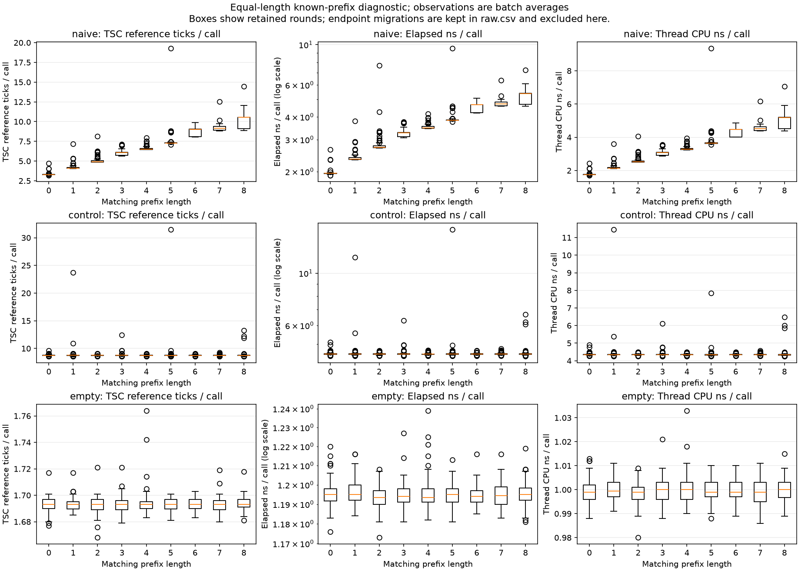
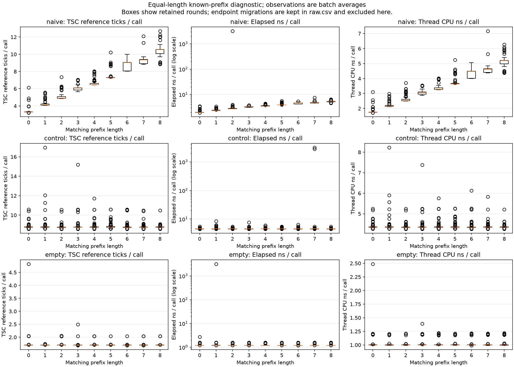

# Linux integration validation — October 27, 2026

This is a new measured Linux experiment, separate from the historical Windows
results. The implementation is based on `timing-with-ML` at
`b318157ac56d3ec596f303ab8afac1a294448c37`, plus the locally prepared Linux port.
The exact tested sources are identified in [report.json](report.json); the
compiler command and native source/library hashes are in
[build-metadata.json](build-metadata.json). Changes were not committed or pushed.

## Observed validation

- Host: `cidu-10114.ctisl.gtri.org`, Intel i7-14700, Linux x86-64, Python 3.12.3,
  GCC 13.3, pinned to allowed CPU 0. CPUID checks for RDTSCP/invariant TSC passed.
- V2 tests on the server: 20 passed; one Windows-only native test skipped. All
  three Linux native tests executed. Naive-checker and V1 portable suites also
  passed locally; Windows native behavior was not revalidated.
- Reviewed GCC disassembly: early-exit comparison remains in `vulnerable`;
  `fixed_work` accumulates differences through the entire equal-length input;
  the batch loop repeatedly calls the comparator. No artificial work is present.
- Two final diagnostics: 100 rounds, batch 1,000, different order seeds, same
  eight-byte known secret. Each run accounted for 2,727,022 calls, restored
  affinity, and observed zero endpoint migrations. Raw data and disassembly
  remain in the server directories below. Earlier development diagnostics are
  preserved separately as `validation-a` and `validation-b`.
- Collection completed 36 shards with a 12/3/3 password split. Every shard's raw
  checksum and summed batch count were audited: **152,352,000** collection calls,
  including warmups and empty baselines.
- Training completed 10 epochs without using test features for selection.
  All 12 blind recovery runs completed with one acceptance check each, totaling
  **28,080,012** calls. Raw batch counts, checksums, verification logs, and budgets
  were audited against the reports. Current server and local source hashes match.
- A portable feature archive exported successfully and trained for one epoch
  on the Mac's ARM64 Python, with no native library required there. That is a
  portability check, not a second native experiment.

| Checker | Fixed-sample ML | Fixed-sample median |
| --- | ---: | ---: |
| Naive | 3/3 | 2/3 |
| Fixed-work control | 0/3 | 0/3 |

The full unedited [generated report](REPORT.md) retains failures and query
counts. These three held-out passwords establish integration only; they do not
establish a reliable recovery rate, ML superiority, or a proof of constant time.
No settings were tuned after observing this test set. Batched same-process
measurements do not demonstrate an external-process or network timing attack.

## Known-prefix plots

The naive checker shows a repeatable increase as more bytes match. The control
and empty baseline medians remain comparatively flat. Each point represents
one batch average; outliers are retained and elapsed time uses a logarithmic axis.

Machine-readable summaries: [A](diagnostic-a.json), [B](diagnostic-b.json).
The volatile secret reads follow the inherited laboratory comparator; results
do not establish the behavior of ordinary production comparisons.

## Retained complete artifacts

Server root:
`/home/cgossmann3/timing-ml-linux-pilot.Xa3ai86N/pswd-checker-v2`

- `diagnostics/final-a/` and `diagnostics/final-b/`: raw measurements, config,
  report, SVG/PNG distributions, and exact compiled disassembly.
- `datasets/server-validation-pilot/`: manifest, raw CSV shards and feature shards.
- `models/server-validation-pilot.json`: the evaluated model.
- `research_results/server-validation-pilot/`: reports, progress, raw blind timing
  traces, and acceptance queries.
- `datasets/server-validation-training.zip`: the exported portable training bundle.
- `.venv/installed-packages.txt`: plotting dependencies, including Matplotlib 3.11.2.

This selected snapshot omits bulk raw data and binaries. Do not reconstruct
the original dataset by sampling the same seed: previous-manifest exclusions
also affect the sampled secrets. Preserve the complete server artifacts.

Follow the [Linux runbook](../../../pswd-checker-v2/LINUX_RUNBOOK.md) for your own
fresh diagnostic runs and the staged learning checkpoints. Use fresh output
names and keep these validation artifacts intact.
