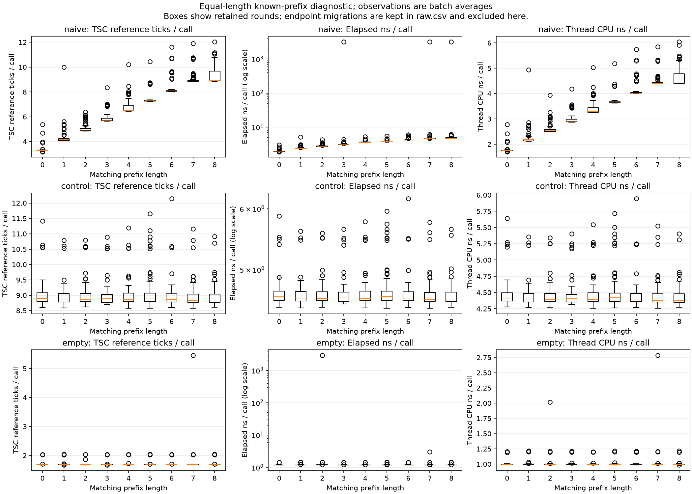
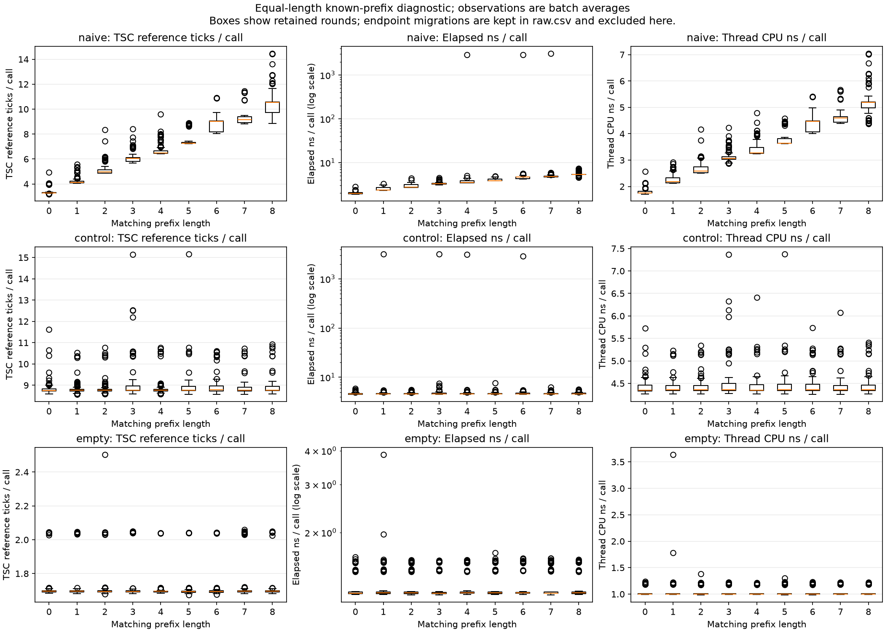

# Linux user-run pilot — October 28, 2026

Christopher followed the Linux runbook on the project server. This snapshot
records his completed experiment, `20261028T180716Z`, separately from the
[October 27 port validation](../linux-pilot-2026-10-27/README.md). The diagnostic
and evaluation reports here are unchanged copies of the server outputs.

## Natural timing diagnostic

Both runs used an eight-byte known diagnostic secret, randomized order, 100
rounds, batches of 1,000 unchanged comparisons, CPU 0, and `work=0`. Both passed
functional checks, restored affinity, and reported zero endpoint migrations.
Each accounted for 2,727,022 checker calls including warmups and acceptance checks.

| Matching prefix length | Run A median TSC ticks/call | Run B median TSC ticks/call |
| ---: | ---: | ---: |
| 0 | 3.287 | 3.288 |
| 2 | 4.918 | 4.973 |
| 4 | 6.513 | 6.489 |
| 6 | 8.073 | 9.029 |
| 7 | 8.867 | 9.151 |
| 8 (full match) | 8.897 | 10.540 |

The naive checker shows increasing timing with matching-prefix length. Control
medians are comparatively flat: 8.818–8.911 ticks/call in A and 8.758–8.782 in B.
The near tie between prefixes 7 and 8 in run A illustrates why the final byte can
be difficult; the full-match effect differs between runs. This is evidence of
leakage in this batched laboratory setting, not a guarantee for every position.

Diagnostic summaries: [A](diagnostic-a/report.json), [B](diagnostic-b/report.json).
Elapsed time is plotted on a logarithmic scale and outliers are retained. Values
are batch averages; repeated calls inside a batch are not independent samples.
TSC reference ticks are not actual core cycles. Linux thread CPU time is recorded
as nanoseconds, not renamed Windows cycle counts.

## ML versus median ranking

Collection completed **36/36 shards** for 18 synthetic passwords, lengths 4–6,
the full 36-character lowercase/digit alphabet, and two collection sessions.
The split was 12 train / 3 validation / 3 test passwords. All observations of
a secret stay in one split. The collector's exclusions produced secrets disjoint
from the earlier pilot. The model used 10 epochs and the test set was not used
for selection.

Fresh blind recovery used fixed sampling only, 12 measured rounds plus one
warmup per candidate, batch 1,000, and one final acceptance check. No final-byte
enumeration, adaptive sampling, or beam search was enabled.

| Checker | ML recovered | Median recovered | Mean checker calls per password/method |
| --- | ---: | ---: | ---: |
| Naive | 3/3 | 2/3 | 2,340,001 |
| Fixed-work control | 0/3 | 0/3 | 2,340,001 |

The median method recovered the four- and five-character secrets. On the
six-character secret it got the first five characters right and rejected its
final guess after choosing the wrong last character. This failed run is retained
in the [machine-readable report](report.json). Read the unedited
[generated report](REPORT.md) for all aggregate results and limitations.

Both methods had the same per-password budget: 1,872,001 calls for length 4,
2,340,001 for length 5, and 2,808,001 for length 6, each including its final
acceptance check. The audit verified raw/feature checksums, batch sums,
verification logs, source/native-library fingerprints, and dataset/model/report
hashes. Totals were **152,352,000 collection calls** and **28,080,012 evaluation calls**.
See [provenance.json](provenance.json).

There are only three test passwords. These results show the Linux pipeline
works; they do not establish ML superiority, a reliable recovery rate, or a
proof that the control is constant time. The measurements are same-process
batches on one server, not individual network requests. The next study should
predeclare more held-out secrets and independent sessions before examining test
outcomes, while retaining failed attempts and equal query budgets.

## Reproduction and retained data

Use the [Linux runbook](../../../pswd-checker-v2/LINUX_RUNBOOK.md) or the
[repository quickstart](../../../../README.md). Server root:

`/home/cgossmann3/timing-ml-linux-pilot.Xa3ai86N/pswd-checker-v2`

- `diagnostics/20261028T180716Z-a/` and `diagnostics/20261028T180716Z-b/`
- `datasets/20261028T180716Z-pilot/`
- `models/20261028T180716Z-pilot.json`
- `research_results/20261028T180716Z-pilot/`

Complete raw data, feature shards, model, source, and native build remain on the
server. The selected reports/plots in this repository are not the complete
dataset. Preserve the original manifests and their exclusion history; the seed
alone does not reproduce the original password set. Rebuilding or changing
source requires a new versioned experiment.
