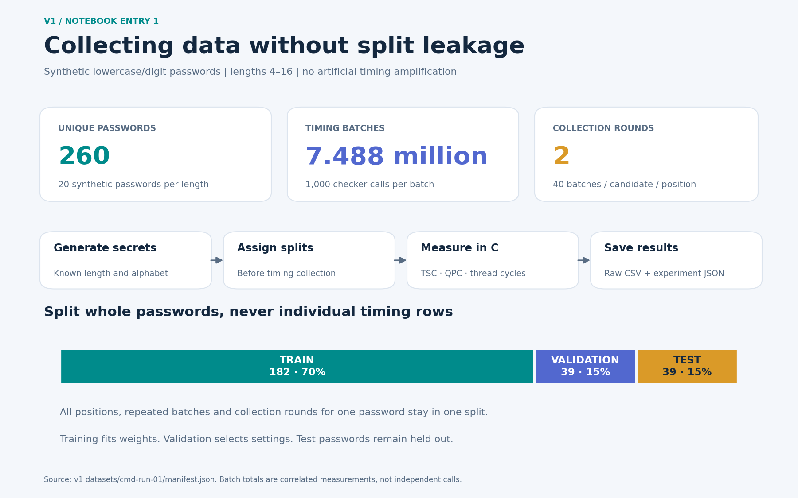
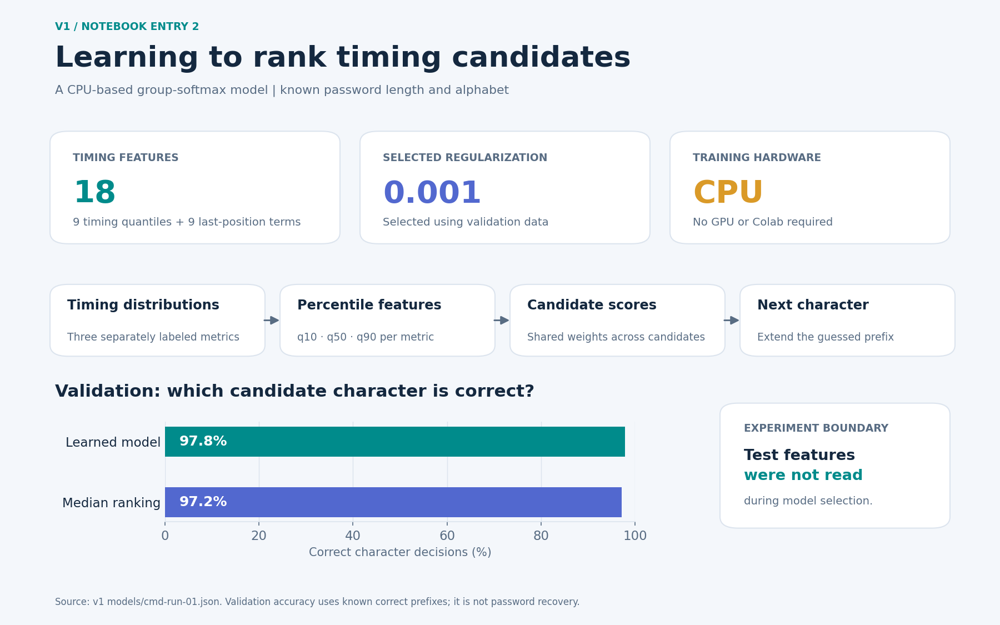
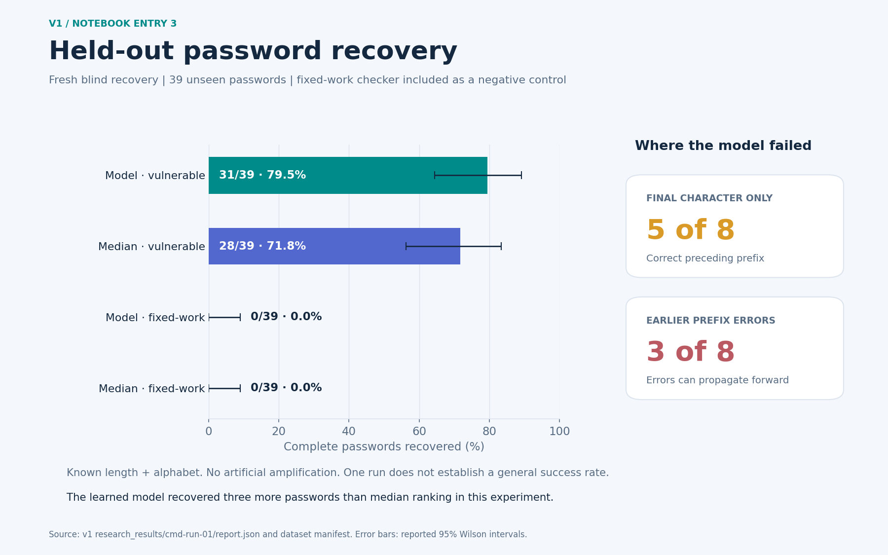
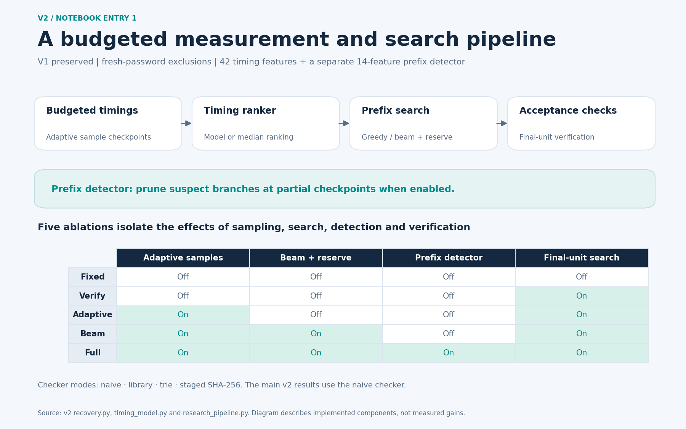
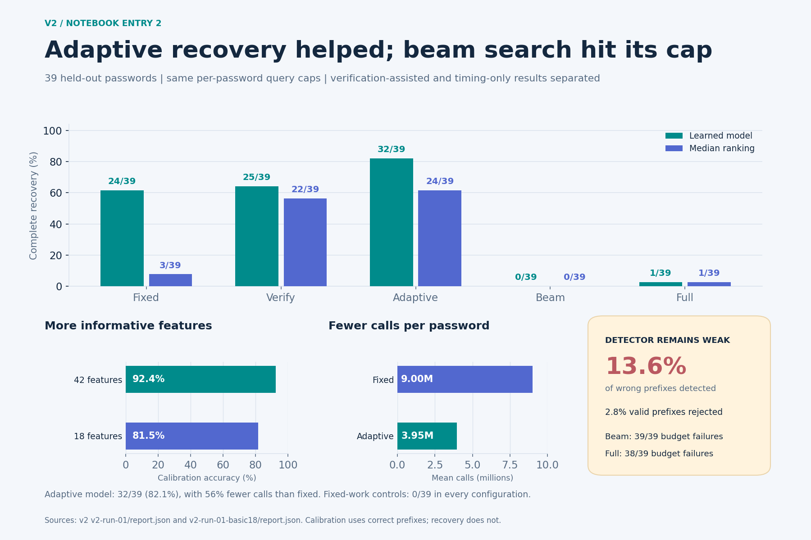
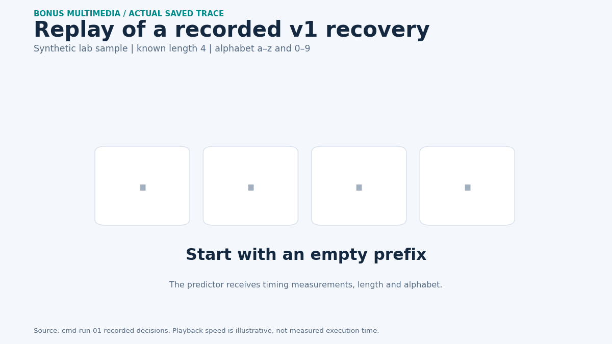

# Figures for the five notebook entries

These are retrospective graphics generated from saved experiment results and source code, not screenshots captured during the notebook weeks. Week headings match the requested notebook organization; original measurement timestamps remain in the source manifests.

PNG files are ready to upload. SVG files are editable. Drag each PNG into the GitHub notebook editor to obtain a hosted image URL, or commit the media and use a path that resolves from your notebook. Local Windows paths will not display on GitHub.

## 10/12/2026 — Entry 1

Collected synthetic timing data and split whole passwords before measurement.

## 10/12/2026 — Entry 2

Trained the v1 timing ranker and selected regularization using validation data.

## 10/12/2026 — Entry 3

Compared held-out recovery with median ranking and the fixed-work control.

## 10/19/2026 — Entry 1

Implemented v2 measurement/search components with separate ablations and query caps.

## 10/19/2026 — Entry 2

Compared v2 recovery, query costs, feature sets and prefix-detector limitations.

## Optional animation for v1 Entry 3

The animation replays the actual recorded decisions for the successful synthetic guess `t767`. Its playback timing is illustrative. It does not fabricate new measurements.

## Rebuild

Run `python generate_media.py` from this folder with matplotlib, NumPy and Pillow installed. The source JSONs must remain at their versioned project paths. No experiment files are changed.
